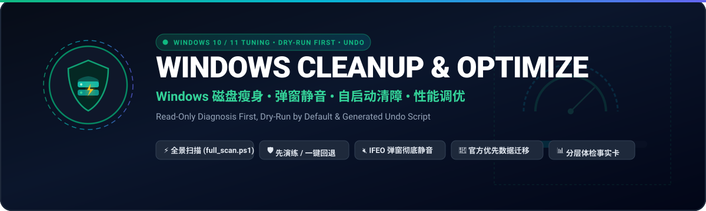

<p align="center">
  
</p>

# Windows Cleanup & Optimization Assistant

<div align="center">

**An Agent Skill for Windows 10/11: read-only diagnosis first, then a tiered plan. Every change is previewed, applied only after you confirm, logged, and reversible through a generated undo script.**

[](LICENSE)
[](CHANGELOG.md)
[](SKILL.md)
[](SKILL.md)

[English](./README.en.md) | [中文](./README.md)

</div>

---

## What it does

When your C drive is full, boot is slow, pop-up ads keep coming back, or chat apps and dev caches have eaten tens of GB, an agent following this skill does not start deleting, and it does not turn off Defender or Windows Update.

## Why it is safe to use

| Mechanism | How |
|---|---|
| Read-only diagnosis | `scripts/full_scan.ps1` writes nothing but its report (to `%TEMP%\wco`) and states whether it ran with full rights |
| Dry run by default | Every write operation prints what it would do and how much it would free; `-Apply` actually does it |
| Truly recoverable deletes | Items go to the Recycle Bin only. Deletion is refused on volumes without a Recycle Bin (USB, network), when the bin is set to delete immediately, or when the item exceeds the bin's size limit, because Windows would otherwise delete permanently in those cases |
| Change log and undo | Service, registry and IFEO changes record the original value in `changes.json` and generate `undo.ps1`; services go back to their original start type, not always `auto` |
| Official paths first | Windows Cleanup recommendations and Storage Sense, in-app "change storage location", Dev Drive for package caches; `mklink` is the last resort |
| Four risk tiers | 🟢 one confirmation for the batch, 🟡 per group, 🟠 per item with the trade-off stated, 🔴 not done by default |

## Coverage

- **Disk**: system caches, update leftovers, Windows.old, WinSxS analysis, dev and AI model caches, official migration for WeChat 4.x / WeCom / QQ NT / DingTalk
- **Software**: winget inventory and uninstall, deep leftovers, IFEO pop-up silencing, 3-second pop-up locator, 360 / 2345 / WPS playbooks
- **Startup**: 20+ startup points, Edge/Chrome startup boost and background mode, WMI persistence and shortcut hijack audit, measured boot time
- **Performance**: 50+ services by user profile, Copilot / Recall switches, memory-leak detection, a skeptical take on "RAM cleaners"
- **Pitfalls**: 86 field notes plus deep-water baselines (DISM, Installer, VSS, cloud files)

## Install

Tell your agent:

> Install the windows-cleanup-optimize skill: clone `https://github.com/hyt315/windows-cleanup-optimize` into your skills directory (e.g. `~/.claude/skills/windows-cleanup-optimize` or `~/.agents/skills/windows-cleanup-optimize`).

| Platform | Command |
|---|---|
| Claude Code | `git clone https://github.com/hyt315/windows-cleanup-optimize.git ~/.claude/skills/windows-cleanup-optimize` |
| Codex / generic | `git clone https://github.com/hyt315/windows-cleanup-optimize.git ~/.agents/skills/windows-cleanup-optimize` |
| Cursor | `git clone https://github.com/hyt315/windows-cleanup-optimize.git ~/.cursor/skills/windows-cleanup-optimize` |
| GitHub CLI 2.90+ | `gh skill install hyt315/windows-cleanup-optimize windows-cleanup-optimize --agent claude-code --scope user` |

## Run the scan yourself

```powershell
# In an elevated PowerShell, from the repo folder
powershell -NoProfile -ExecutionPolicy Bypass -File .\scripts\full_scan.ps1
```

## Layout

```
windows-cleanup-optimize/
├── SKILL.md                 # workflow, safety rules, symptom-to-manual routing
├── references/              # 14 manuals, read on demand
├── scripts/
│   ├── full_scan.ps1        # one-shot read-only scan
│   ├── templates/           # 22 templates (tNN-*.ps1)
│   ├── lib/Wco.Common.psm1  # recycle-bin checks, change log, undo
│   └── selftest.py          # structure / counts / BOM / syntax checks
├── data/volatile-paths.json # fast-changing app paths with review dates
├── evals/                   # trigger and behavior evals
└── tests/                   # Pester unit tests
```

## Tests

```powershell
python scripts/selftest.py   # no dependencies; PowerShell syntax check is SKIPped if PowerShell is missing
Invoke-Pester ./tests        # Pester 5+
```

CI runs on Ubuntu and Windows; the Windows job actually runs `full_scan.ps1` and compares service state before and after to prove the scan changed nothing.

## FAQ

- **Can it delete something by mistake?** Deletes go to the Recycle Bin, and the three cases where that would silently become permanent are refused. Still, look before you empty the bin.
- **Why won't it disable Defender or updates?** Near-zero gain, large risk. Developers get speed from Dev Drive, where Defender switches to performance mode automatically.
- **Windows 10?** Supported, but Windows 10 reached end of regular support on 2025-10-14, which is one more reason not to turn off updates.

## Contributing

Issues and PRs welcome, see [CONTRIBUTING.md](CONTRIBUTING.md). If you change path-related knowledge, update its review date in `data/volatile-paths.json`.

## License

[MIT](LICENSE)
