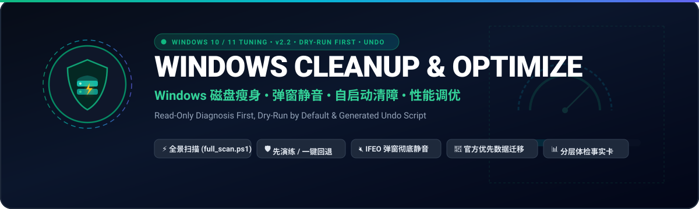

<p align="center">
  
</p>

# 🧹 Windows Cleanup & Optimization Assistant

<div align="center">

**A Windows cleanup skill that runs a read-only diagnosis first, then proposes a tiered plan. It ships 14 reference manuals, 25 script templates, and 84 real-world pitfalls. Every change is previewed first, applied only after you confirm, logged, and reversible through a generated undo script.**

[](CHANGELOG.md)
[](LICENSE)
[](CHANGELOG.md)
[](https://github.com/hyt315/windows-cleanup-optimize/actions/workflows/ci.yml)
[](SKILL.md)
[](SKILL.md)
[](https://github.com/hyt315/windows-cleanup-optimize/stargazers)

[English](./README.en.md) | [中文](./README.md)

</div>

---

## 📖 What is this?

C drive in the red, slow boot, pop-ups that keep coming back, background lag: **Windows Cleanup & Optimization Assistant** is a Windows 10 / 11 maintenance skill for AI agents. You can also run its scripts yourself.

It avoids "one-click cleanup" and follows these principles:

- **Scan read-only first** and decide based on measured numbers.
- **Delete only to the Recycle Bin**, and only after checking that the bin can actually hold the item.
- **Use official migration paths first.**
- **Give every change a risk tier.** Preview it first, apply it only after you confirm, and keep an undo script.

## 🆕 Latest release v2.2.1 (2026-11-23)

This release backs "never lose data, never misjudge, always undoable" with automated and real-Windows verification, while expanding read-only diagnostics for binary proxy flags, competing gateways, and boot errors.

- **undo now reports whether it actually restored**: `undo.ps1` runs each step separately and checks it; a failed step (e.g. not run as admin) does not stop the rest, and the script ends with the failed steps listed and exit code 1. It is safe to run again.
- **Windows verification & CI write → undo → compare loop**: verified across Windows PowerShell 5.1 and PowerShell 7 (including HKCU closed-loop tests and 39/39 negative controls); on the CI Windows runner, registry values, IFEO, registry key deletion, service start type/deletion, scheduled task disable/delete, and startup toggles are applied, undone, and compared byte-for-byte.
- **Deeper network, proxy & boot-error diagnostics (T23 / T24 / pitfalls 83–84)**: T23 now inspects binary `Connections` per-connection and dial-up `byte[8]` flags (`PROXY`/`PAC`/`WPAD`) and corrupted entries, competing multi-NIC IPv4 default gateways (e.g. bridged-modem DHCP gateways stalling Settings Home), and leftover administered TCP port exclusion ranges; T24 detects duplicate `Run` + `Logon` scheduled-task autostart channels and correlates the past 7 days of SCM boot/service errors (Event IDs `7000`/`7023`/`7026`).
- **False-positive fixes**: name normalization no longer relies on `\b` (which does not work next to CJK characters), so names like `微信4.1.0.34`, `钉钉v7.6.5` and `QQ9.9.15` match their installed programs; the full scan's bloatware section now uses the catalog's own matching rules and shows confidence instead of flagging every family (and popular apps such as Baidu Netdisk) with ⚠️.
- **One more recycle-bin guard**: paths that pass through a junction are refused, because the real volume (and its recycle-bin policy) may differ from the drive letter.
- **Negative controls**: 39 safety checks are each switched off in turn and a test fails every time; template, manual, pitfall and family counts and referenced function names are checked automatically.
- **Freshness fixes (verified 2026-11-23)**: Recall's snapshot store is `CoreAIPlatform.00\UKP\{GUID}`; WSL `--compact` is available from stable 3.0.1; NTFS last-access defaults to "system managed"; Windows 11 26H2 is out; WeCom and `Weixin.exe` now cite official sources. See [CHANGELOG.md](CHANGELOG.md).

Highlights of v2.2.0 and earlier:

- **Native Win32 fast sizing, dead-proxy and virtual NIC audits, orphaned autostart/service/driver and `StartupApproved` ghost detection, 2025–2026 AI tool caches** (v2.2.0).

- **Bloatware & reversible uninstall**: `data/bloatware-catalog.json` + T25 inventory + `Invoke-WcoUninstall` / `Remove-WcoAppxPackage` / `Find-WcoLeftover` (services, tasks, and registry keys are exported before removal and restorable via `undo.ps1`; name-only leftover matches stay 🟡 suspected).
- **Autoruns-grade autostart & browser-hijack audits**: T24 covers 16 persistence categories (RunOnceEx, Winlogon, IFEO/SilentProcessExit, AppInit, LSA, Winsock, hidden tasks, WMI, non-Microsoft drivers, Win11 `RestartApps`, etc.); T23 audits browser policies, forced extensions, hosts, DNS, and root certificates.
- **Sectioned error transparency & unified measurement**: `[CHK]` reports section status without hiding failures as "clean"; every template uses `Measure-WcoDirectory` to prevent double-counting across junctions.

---

## ✨ Key Features

| Core Module | Capabilities | Value Delivered |
|---|---|---|
| **🛡️ Reversible by design** | Write operations dry-run by default and apply only with `-Apply`. Changes are logged to `changes.json`, and an `undo.ps1` is generated. Services are restored to their original start type | Every step is visible and can be undone |
| **🗑️ Truly recoverable deletes** | Deletes go to the Recycle Bin only. Deletion is refused on volumes without a bin (USB, network), when the bin is set to delete immediately, or when exceeding bin capacity; long paths report `LongPath` | Nothing is "sent to the bin" and silently gone for good |
| **🔍 One scan entry point** | `full_scan.ps1` runs every read-only check with native Win32 sizing (incl. `[EXT]` T23–T25 summaries and `[CHK]` section health), infers the user profile, checks admin rights, and measures boot time | No questionnaire first; the health card comes straight from the scan |
| **🧹 Bloatware & orphan detection** | 64-family catalog matched by publisher / signer / process / service / task / driver; browser policy, `Connections` binary proxy, multi-gateway & TCP exclusion audits; `StartupApproved` ghosts, duplicate autostart & SCM boot errors; IFEO pop-up silencing | Every uninstall is checked by a rescan, and leftover cleanup is reversible |
| **🤖 2026 Dev & AI environment tuning** | Dev Drive for package caches + npm/pnpm/uv/pip/NuGet/Go/Docker official CLI purge matrix; 2025–2026 AI IDE/Agent caches & Ollama/HF/AVD/LM Studio env vars; WSL2 compaction (`wsl --manage --compact`) | Tens of GB freed without turning off Defender |
| **⚡ Win11 24H2+ modern tuning** | 50+ services tuned by profile, Widgets tuning, Copilot / Recall (snapshot store), vNIC route/metric, multi-NIC gateway & battery Wi-Fi power-saving checks, Balanced power plan, SSD TRIM | Each item cites its official source and cost; anything unsourced is marked "unverified" |
| **🔄 Official data migration** | Windows Cleanup recommendations and Storage Sense first. WeChat 4.x / WeCom / QQ NT / DingTalk move through in-app settings. `mklink` is a last resort | App updates keep working |
| **📋 14 reference manuals** | Disk cleanup, Windows.old, uninstalling, services, startup mechanisms, chat-app migration, 84 pitfalls grouped by topic | The agent reads only the manual the problem needs |

---

## 📊 6-Stage Workflow

```
[Input: Drive C full / slow boot / stutter / pop-ups]
                            │
         [Stage 1: Read-only diagnosis]
         full_scan.ps1 / auto profile / admin check / measured boot time
                            │
         [Stage 2: Health card & tiers]
         Disk · Boot · Software · Background / 🟢🟡🟠🔴 plan
                            │
         [Stage 3: Pick a preset]
         Caches only / Standard / Deep, or pick items yourself
                            │
         [Stage 4: Dry run, then apply on confirmation]
         Recycle-bin checks / backup and original values before removal / restore point recommended
                            │
         [Stage 5: Verify & roll back]
         Before/after space and boot time / undo.ps1
                            │
         [Stage 6: One-page report]
         What was freed, what changed, where the undo script is
```

---

## 🚀 Quick Start

This is an AI Agent Skill. Install it into your AI assistant and it is ready to use.

### Option A: Paste one sentence into any Agent (recommended, most universal)

Send this to your AI assistant. It will detect the platform and clone the skill into the right directory:

> Please install the windows-cleanup-optimize skill: clone `https://github.com/hyt315/windows-cleanup-optimize` into your skills directory (e.g. `~/.claude/skills/windows-cleanup-optimize` or `~/.agents/skills/windows-cleanup-optimize`) and confirm it works. When I report disk full, slow boot, pop-ups or lag, follow the 6-stage workflow in SKILL.md: diagnose read-only first, preview every change, and apply it only after I confirm.

### Option B: GitHub CLI 2.90+ (one command)

```bash
gh skill install hyt315/windows-cleanup-optimize windows-cleanup-optimize --agent claude-code --scope user
```

### Option C: Manual per-platform install

| Platform | Command |
|---|---|
| **Claude Code** | `git clone https://github.com/hyt315/windows-cleanup-optimize.git ~/.claude/skills/windows-cleanup-optimize` |
| **Codex** | `git clone https://github.com/hyt315/windows-cleanup-optimize.git ~/.agents/skills/windows-cleanup-optimize` |
| **Cursor** | `git clone https://github.com/hyt315/windows-cleanup-optimize.git ~/.cursor/skills/windows-cleanup-optimize` |
| **General Agents** | `git clone https://github.com/hyt315/windows-cleanup-optimize.git ~/.agents/skills/windows-cleanup-optimize` |

### Option D: Run the scan and tests yourself

```powershell
# Elevated PowerShell, from the repo folder; the scan is read-only and its report opens with a pre-flight check
powershell -NoProfile -ExecutionPolicy Bypass -File .\scripts\full_scan.ps1   # read-only, report in %TEMP%\wco
python scripts/selftest.py                                                    # structure / counts / BOM / syntax
Invoke-Pester ./tests                                                         # module unit tests (Pester 5+)
python tests/negative_controls.py                                             # negative controls: switch off each guard, a test must fail
```

---

## 🔒 Safety Principles

1. **Read-only diagnosis.** Scans change no settings and delete nothing. To prove it, CI runs the scan on Windows and compares services, Run keys and the power plan before and after.
2. **Preview, confirm, then apply.** Each tier needs a different level of confirmation:
   - 🟢 One confirmation covers the whole list.
   - 🟡 Confirm per group.
   - 🟠 Confirm per item, with the trade-off stated.
   - 🔴 Not done by default.
3. **Recoverable deletes.** Items go to the Recycle Bin only. The three cases where that would silently become permanent are refused.
4. **Reversible changes.** Service, registry and IFEO changes record the original value and generate `undo.ps1`. Services, scheduled tasks and registry keys are exported before removal; creating a restore point before touching drivers or system components is recommended.
5. **Official paths first.**
   - For cleanup, start with Windows Cleanup recommendations.
   - For migration, use in-app settings, environment variables or Dev Drive.
   - `mklink /J` is a last resort.
6. **Hard limits.** Never disable Defender or Windows Update, never run `/ResetBase`, never empty `C:\Windows\Installer`.

---

## 📥 Download

| Method | Command / Link |
|---|---|
| **HTTPS** | `git clone https://github.com/hyt315/windows-cleanup-optimize.git` |
| **SSH** | `git clone git@github.com:hyt315/windows-cleanup-optimize.git` |
| **GitHub CLI** | `gh repo clone hyt315/windows-cleanup-optimize` |
| **ZIP** | [Download ZIP](https://github.com/hyt315/windows-cleanup-optimize/archive/refs/heads/main.zip) |
| **Tarball** | [Download Tar](https://github.com/hyt315/windows-cleanup-optimize/archive/refs/heads/main.tar.gz) |
| **Single file (SKILL.md)** | `curl -O https://raw.githubusercontent.com/hyt315/windows-cleanup-optimize/main/SKILL.md` |

---

## 📖 14 Reference Manuals

| Reference Guide | Core Focus | When to Read | Estimated Time |
|---|---|---|---|
| 📑 [**Scan Scripts Index (`scan-scripts.md`)**](references/scan-scripts.md) | What each of the 25 templates does and when to use it; code lives in `scripts/templates/` | When running scans & cleanup | 2 mins |
| 🛡️ [**Pitfalls (`pitfalls.md`)**](references/pitfalls.md) | 84 pitfalls grouped by topic (safety baseline, deletion and permissions, false positives, startup, uninstall, migration, performance & proxy/vNIC) | Before making a plan | 5 mins |
| 🚀 [**Startup Audit (`startup-audit.md`)**](references/startup-audit.md) | Startup & `StartupApproved` ghost audit; Edge / Chrome policies; `wscript.exe //B` windowless background tasks | Slow boot | 3 mins |
| 🧩 [**Startup Mechanisms (`startup-mechanisms.md`)**](references/startup-mechanisms.md) | Startup points mapped to every Autoruns category, the template that checks each, and how to turn it off reversibly | Stubborn autostarts | 3 mins |
| 🧹 [**Bloatware Catalog (`bloatware-catalog.md`)**](references/bloatware-catalog.md) | Signatures for 360 / 2345 / Sogou / Baidu suites & standalone security leftovers, IFEO pop-up silencing | Pop-up adware | 3 mins |
| 🗑️ [**Software Uninstall (`software-uninstall.md`)**](references/software-uninstall.md) | winget inventory, deep leftovers, WPS / 360 / DingTalk playbooks (official uninstaller first) | Removing stubborn apps | 4 mins |
| 💾 [**System Cleanup (`system-cleanup.md`)**](references/system-cleanup.md) | Windows Cleanup recommendations, Windows.old, cleanmgr, DISM, driver store, Win11 24H2 Recall & CLI cache purge matrix | Reclaiming C drive | 4 mins |
| ⚙️ [**Services (`services-optimization.md`)**](references/services-optimization.md) | 50+ services by profile, Copilot / Recall switches, rollback to original values | Reducing background load | 4 mins |
| 🧠 [**Memory (`memory-optimization.md`)**](references/memory-optimization.md) | Real leak detection, memory compression, working-set analysis | High RAM usage | 3 mins |
| ⚡ [**Performance (`performance-tuning.md`)**](references/performance-tuning.md) | Power plans, visual effects, TRIM, Dev Drive, plus binary `Connections` proxy recovery, multi-gateway/TCP exclusion & battery Wi-Fi tuning | Responsiveness | 3 mins |
| 📂 [**Official Migration (`drive-migration-official.md`)**](references/drive-migration-official.md) | Migration decision tree, Dev Drive package caches, Ollama/HF & 2025–2026 AI IDE/Agent directories | Moving dev & model folders | 4 mins |
| 💬 [**Chat Apps (`chat-apps-migration.md`)**](references/chat-apps-migration.md) | Official migration and cache cleanup for WeChat 4.x / WeCom / QQ NT / DingTalk | Huge chat-app folders | 3 mins |
| 🔗 [**Junction Fallback (`mklink-migration.md`)**](references/mklink-migration.md) | `mklink /J` limits, preflight checks, failure cases | When only a junction will do | 3 mins |
| 📚 [**Migration Cases (`migration-cases.md`)**](references/migration-cases.md) | End-to-end real cases, including TRAE / VS Code AI IDEs | Reviewing whole workflows | 4 mins |

---

## 📁 File Structure

```
windows-cleanup-optimize/
├── SKILL.md                          # Safety rules, 6-stage workflow, symptom-to-manual routing
├── README.md                         # Chinese documentation
├── README.en.md                      # English documentation
├── CHANGELOG.md                      # Version history
├── LICENSE                           # MIT License
├── CONTRIBUTING.md                   # Contribution guide
├── CODE_OF_CONDUCT.md                # Code of conduct
├── SECURITY.md                       # Security policy
├── PSScriptAnalyzerSettings.psd1     # PSScriptAnalyzer rules config
├── manifest.json                     # Skill manifest
├── assets/banner.svg                 # Repository hero banner
├── .github/workflows/ci.yml          # Ubuntu + Windows CI
├── scripts/
│   ├── full_scan.ps1                 # One-shot read-only scan
│   ├── templates/                    # 25 templates (tNN-*.ps1)
│   ├── lib/Wco.Common.psm1           # Win32 fast dir sizing, recycle checks, undo, uninstall & autostart
│   └── selftest.py                   # Automated regression test runner
├── data/volatile-paths.json          # Fast-changing app paths with review dates
├── data/bloatware-catalog.json       # Bloatware & security-leftover catalog (64 families)
├── evals/                            # Trigger and behavior evals
├── tests/                            # Pester unit tests, Windows closed-loop tests, negative controls
└── references/                       # 14 reference manuals (incl. 84 pitfalls)
```

---

## ❓ FAQ

- **Q: Can cleaning delete my files by mistake?**
  A: Deletes go to the Recycle Bin. The three cases where that would become permanent (no bin on the volume, bin set to delete immediately, item over the bin's limit) are refused. Still, take a look before emptying the bin.
- **Q: Why won't it disable Defender or Windows Update?**
  A: The gain is near zero and the risk is large. Developers get speed from Dev Drive, where Defender switches to performance mode automatically once the drive is trusted and real-time protection is on.
- **Q: How are WeChat 4.x and QQ NT data moved safely?**
  A: With each app's own storage-location setting, never with mklink. After the move, check that drive C stops growing.
- **Q: What if a change goes wrong?**
  A: Every run generates `undo.ps1`. It restores services to their original start type and restores the registry from the backup exported before the change.
- **Q: Windows 10?**
  A: Supported. But Windows 10 reached end of regular support on 2025-10-14, and consumer Extended Security Updates (ESU) run until 2027-10-12 (enroll from the Windows Update page). That is one more reason not to turn off updates or security software.

---

## 🤝 Contributing

Contributions are welcome! See [CONTRIBUTING.md](CONTRIBUTING.md). If this skill helped you, please give it a [Star ⭐](https://github.com/hyt315/windows-cleanup-optimize/stargazers)!

---

## 📄 License

Licensed under the [MIT License](LICENSE).

---

> 🌏 **中文版: [README.md](./README.md)**
