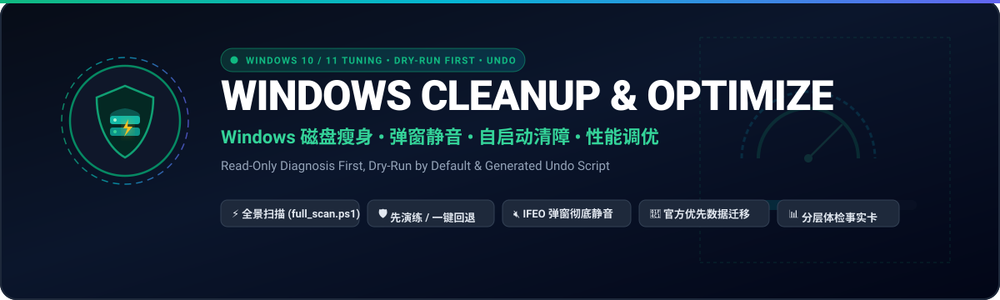

<p align="center">
  
</p>

# Windows 清理与优化助手

<div align="center">

**给 AI Agent 用的 Windows 10/11 清理技能：先只读诊断，再分档给方案；每个改动先演练、经你确认才执行、自动留痕，并生成一键回退脚本。**

[](LICENSE)
[](CHANGELOG.md)
[](SKILL.md)
[](SKILL.md)

[English](./README.en.md) | [中文](./README.md)

</div>

---

## 它解决什么

适用场景：

- C 盘红了
- 开机慢
- 弹窗广告、流氓软件卸不干净
- 微信 / QQ 占了几十 GB
- 开发缓存把 C 盘撑满

在这些场景下，Agent 按这个技能的流程办事：**不会一上来就删，也不会去关 Defender 和 Windows Update**。

## 怎么做到"放心"

| 机制 | 具体做法 |
|---|---|
| 只读诊断 | `scripts/full_scan.ps1` 只读不写。报告写到 `%TEMP%\wco`，开头注明当前权限是否完整 |
| 先演练 | 所有写操作默认只打印"将会做什么、能释放多少"，加 `-Apply` 才执行 |
| 真正可恢复 | 删除只进回收站。卷没有回收站（U 盘、网络盘）、回收站设为直接删除、体积超过回收站上限时，一律拒绝执行，因为这三种情况下会变成永久删除 |
| 留痕与回退 | 服务、注册表、IFEO 改动都会记下原值，写入 `changes.json`，并生成 `undo.ps1`。服务会恢复成原来的启动类型，不是一律改回 auto |
| 官方入口优先 | 先用 Windows "清理建议"、存储感知，以及软件自带的"更改存储位置"；开发者用 Dev Drive 放包缓存；mklink 只作兜底 |
| 分四档确认 | 🟢 一次确认批量执行；🟡 按组确认；🟠 逐项确认并说明代价；🔴 默认不做 |

## 覆盖内容

- **磁盘**：系统缓存、更新残留、Windows.old、WinSxS 分析、开发和 AI 模型缓存，以及微信 4.x / 企业微信 / QQ NT / 钉钉的官方迁移
- **软件**：winget 盘点与卸载、深层残留、IFEO 弹窗静音、3 秒定位弹窗进程、360 / 2345 / WPS 专项处理
- **启动**：20+ 个启动点、Edge/Chrome 的启动加速与后台模式、WMI 持久化与快捷方式劫持审计、开机耗时实测
- **性能**：50+ 个服务按画像精简、Copilot / Recall 开关、内存泄漏识别；对"内存清理工具"保持批判态度
- **踩坑库**：86 条实战记录，加一组深水区官方基线（DISM、Installer、VSS、云文件）

## 安装

把下面这句话发给你的 AI 助手：

> 请安装 windows-cleanup-optimize 技能：克隆 `https://github.com/hyt315/windows-cleanup-optimize` 到你的 skills 目录（如 `~/.claude/skills/windows-cleanup-optimize` 或 `~/.agents/skills/windows-cleanup-optimize`）。

或者手动安装：

| 平台 | 命令 |
|---|---|
| Claude Code | `git clone https://github.com/hyt315/windows-cleanup-optimize.git ~/.claude/skills/windows-cleanup-optimize` |
| Codex / 通用 | `git clone https://github.com/hyt315/windows-cleanup-optimize.git ~/.agents/skills/windows-cleanup-optimize` |
| Cursor | `git clone https://github.com/hyt315/windows-cleanup-optimize.git ~/.cursor/skills/windows-cleanup-optimize` |
| GitHub CLI 2.90+ | `gh skill install hyt315/windows-cleanup-optimize windows-cleanup-optimize --agent claude-code --scope user` |

## 不用 Agent，自己跑扫描

```powershell
# 右键“以管理员身份运行” PowerShell，进入仓库目录
powershell -NoProfile -ExecutionPolicy Bypass -File .\scripts\full_scan.ps1
```

## 目录结构

```
windows-cleanup-optimize/
├── SKILL.md                 # 流程、安全底线、按问题找手册的路由表
├── references/              # 14 份手册，用到才读
├── scripts/
│   ├── full_scan.ps1        # 一键只读全量扫描
│   ├── templates/           # 22 个模板（tNN-*.ps1）
│   ├── lib/Wco.Common.psm1  # 回收站预检、留痕、undo 生成
│   └── selftest.py          # 结构 / 计数 / BOM / 语法自测
├── data/volatile-paths.json # 易变路径清单（带核实日期）
├── evals/                   # 触发评测与行为评测
└── tests/                   # Pester 单元测试
```

## 测试

```powershell
python scripts/selftest.py   # 零依赖；没装 PowerShell 时语法检查标 SKIP
Invoke-Pester ./tests        # 需要 Pester 5+
```

CI 会在 Ubuntu 和 Windows 上跑。其中 Windows 那一步会真跑一次 `full_scan.ps1`，并对比运行前后的服务状态，确认扫描没有改动任何东西。

## 常见问题

- **会不会误删？** 删除只进回收站。可能变成永久删除的三种情况，脚本会直接拒绝执行。即便如此，清空回收站前也请看一眼。
- **为什么不帮我关 Defender / 更新？** 收益接近零，风险很大。开发者想提速，可以用 Dev Drive：Defender 在上面会自动切到性能模式。
- **Windows 10 能用吗？** 能用。但 Windows 10 已于 2025-10-14 停止常规支持，更不该关更新。

## 参与贡献

欢迎提 Issue 和 PR，详见 [CONTRIBUTING.md](CONTRIBUTING.md)。改了路径类知识，请同步更新 `data/volatile-paths.json` 里的核实日期。

## 开源协议

[MIT](LICENSE)
